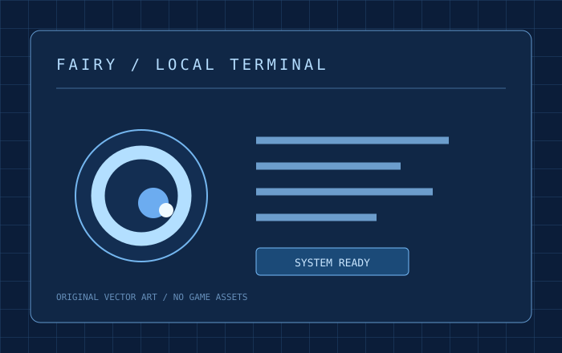

# Fairy Desktop

A Fairy-inspired Windows desktop chat client with a blue terminal interface, configurable chat APIs, local conversations, animated eye states, and optional speech.

[中文](README.md) · [Changelog](CHANGELOG.md) · [Privacy](PRIVACY.md) · [API](docs/API.md)



This is an unofficial fan project, unaffiliated with HoYoverse, miHoYo, DeepSeek, or OpenAI. No game screenshots, soundtrack, character voice recordings, credentials, or user conversations are included.

## Download

Download the Windows x64 ZIP from this repository's Releases, extract the entire archive to a writable folder, and run **启动 Fairy.cmd**. Keep release/Fairy-win32-x64 and all runtime files together. Node.js and Codex are not required for the packaged app. The application is currently unsigned and has no automatic updater. SHA256SUMS.txt accompanies the release.

## Features

- OpenAI-compatible Chat Completions endpoints and a DeepSeek preset.
- Direct model selection, manual model IDs, streaming responses, Markdown, draft recovery, and conversation export.
- Distinct typing, thinking, and answering animations with an optional startup sequence.
- DeepSeek official balance and local daily usage. Missing token reports remain unknown.
- Windows text-to-speech, automatic or manual reading, immediate stop, speed and volume controls.
- A configurable speech API with separate credentials.
- Font size, spacing, effects, shortcuts, generation parameters, and editable character instructions.

The model list has no search field. Conversation search is available separately.

## Configuration

Open Settings, choose a provider, and enter your own base URL and API key. DeepSeek's official base URL is https://api.deepseek.com. Read the available models, select one, then save. Chat requests append /chat/completions to the base URL.

For speech, choose Windows system voices or configure a complete compatible speech endpoint. The system voice is not the original game's character voice. Voice uploads and model training are not built in.

## Development

Requires Node.js 24 and npm. Windows is required for system speech.

```sh
npm ci
npm run check
npm start
```

For packaging:

```sh
npm ci --ignore-scripts
npm run check
npm run package
```

The package script builds from an explicit application allowlist. Private data, exports, caches, development scripts and unrelated root files never enter the staging directory. Audit both the source and final archive before redistribution.

## Privacy and limits

User data is created locally in data/, exports/ and work/ next to the portable installation. Conversations and drafts are plaintext. Desktop API keys use Electron safeStorage on Windows; without encryption support, keys are session-only. Configured providers receive chat or speech requests. No built-in telemetry or cloud sync is included.

Usage is local to this client and grouped by provider type and Beijing calendar date. Rate-period rules were checked on 2026-10-19 and only include the 2026 holiday calendar; they are not a live load indicator or a billing guarantee.

There is no file execution, computer-control, or Codex App Server integration. External speech services may require protocol adapters. See the Chinese README for full operation details.

## License

Apache-2.0 for project code and original vector graphics. Eye animation code is adapted from [Fairy-DSH](https://github.com/Chengzhibense/Fairy-DSH), with its license, NOTICE and provenance retained. Third-party dependencies keep their own licenses. This license grants no rights to third-party characters or trademarks.
